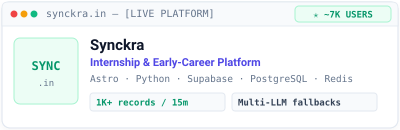
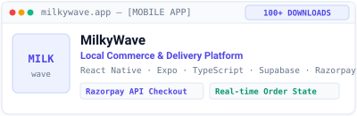
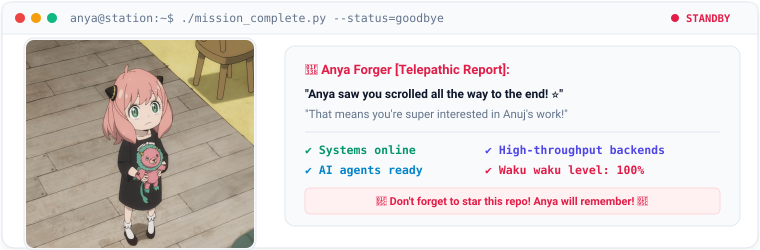

<div align="center">

<!-- Clean Top Status Breadcrumb -->
<code>[ ANYA-OS ] &nbsp; [ STATUS: OPEN FOR FULL-TIME ROLES ] &nbsp; [ HYDERABAD, IN ] &nbsp; [ B.TECH MAY 2026 ]</code>

<br/><br/>

<!-- Clean Branded Header Card featuring Welcoming Anya -->
<a href="https://github.com/Anujyadav911">
  
</a>

<!-- Animated Monospace Typing Line -->
<p align="center">
  <a href="https://github.com/Anujyadav911">
    
  </a>
</p>

<!-- Clean Contact & Navigation Pills -->
<a href="https://github.com/Anujyadav911">
  
</a>
&nbsp;
<a href="https://www.linkedin.com/in/anuj-yadav-506a99257">
  
</a>
&nbsp;
<a href="mailto:anujyadav47247@gmail.com">
  
</a>
&nbsp;
<a href="https://synckra.in">
  
</a>

</div>

---

### <code>guest@anuj-station:~$ whoami.py --verbose</code>

<table width="100%" border="0" cellspacing="0" cellpadding="8">
<tr>
<td width="73%" valign="top">

```python
# anuj-station:~ $ whoami.py
class AnujYadav:
    role         = "AI Engineer Intern @ Mondee Tech Pvt. Ltd."
    location     = "Hyderabad, India"
    education    = "B.Tech in ECE, IIIT Manipur (Graduating May 2026)"
    seeking      = "Full-Time AI Engineering / Backend Software Roles"

    core_focus   = [
        "Autonomous AI Agents & LangGraph",
        "Production RAG Pipelines & Multi-LLM Fallbacks",
        "High-Concurrency Ingestion & Scalable Backends",
    ]
    tech_stack   = [
        "Python", "FastAPI", "React", "TypeScript", "PostgreSQL", "Redis"
    ]
    fuel         = "Chai ☕ + Python 🐍 + Peanuts 🥜"
    allies       = ["Anya Forger 🌸", "Chibi Neko ฅ^•ﻌ•^ฅ"]

    def current_mission(self):
        return "Building production software, scaling systems, shipping products."

me = AnujYadav()
print(me.current_mission())
```

</td>
<td width="27%" align="center" valign="middle">


<p align="center">
  <sub><i>"Simple code, solid architecture."</i></sub>
</p>

</td>
</tr>
</table>

---

#### <code>Verified Engineering Highlights</code>
- <code>data-pipelines</code> &nbsp; **High-Throughput Healthcare Ingestion**: Engineered pipelines handling **15,169 files** and structuring **220,776 transcript turns** for clinical AI systems at Mondee Tech.
- <code>backend-systems</code> &nbsp; **Distributed Booking Architecture**: Developed booking and backend services supporting **10,000+ daily transactions** with Redis quote caching (decreased checkout latency by **45%**).
- <code>llm-orchestration</code> &nbsp; **Multi-Model LLM Workflows**: Designed multi-provider fallback architectures (<em>Gemini &rarr; Groq &rarr; OpenRouter</em>) and autonomous agent workflows with **LangGraph** to reliably parse raw web data.
- <code>healthcare-fhir</code> &nbsp; **Healthcare Interoperability**: Integrated ABHA registration into ABDM kiosks using **Medplum FHIR** standards and mobile OTP verification.
- <code>education</code> &nbsp; **IIIT Manipur**: B.Tech in Electronics and Communication Engineering (2022 &ndash; May 2026, CGPA: 7.46/10). Actively seeking full-time roles.

---


### <code>ls -la ./featured_projects/</code>

<table width="100%" border="0" cellspacing="0" cellpadding="8">
<tr>
<td width="50%" valign="top">

<a href="https://synckra.in">
  
</a>

<br/><br/>

<b>Internship & Early-Career Tech Platform</b>

<p>Career platform helping students and freshers discover verified tech internships and entry-level opportunities across India.</p>

<ul>
<li>Asynchronous ingestion pipelines processing <b>1,000+ job records in 15 mins</b></li><li>Multi-LLM fallback architecture (<b>Gemini → Groq → OpenRouter</b>) to reliably parse raw listings</li><li>Human-in-the-loop dashboard to verify metadata quality and remove invalid records</li><li>Integrated GA4 & Search Console driving organic traffic across <b>~7,000 users</b></li>
</ul>

<b>Tech Stack:</b><br/>
<code>Astro</code> <code>Python</code> <code>Supabase</code> <code>PostgreSQL</code> <code>Redis</code> <code>BullMQ</code>

<br/><br/>

<a href="https://synckra.in"><b>🌐 Live Website</b></a>

</td>
<td width="50%" valign="top">

<a href="https://play.google.com/store/apps/details?id=com.milkywave.customer&pcampaignid=web_share">
  
</a>

<br/><br/>

<b>Local Commerce & Neighborhood Marketplace</b>

<p>A cross-platform mobile marketplace app connecting neighborhood customers with local stores for streamlined ordering and delivery.</p>

<ul>
<li>Cross-platform mobile application developed with <b>React Native</b> and <b>Expo</b></li><li>Relational <b>Supabase PostgreSQL</b> schema for vendor catalogs, customers, and order states</li><li>Integrated <b>Razorpay API</b> for secure digital payments and checkout flows</li><li>Asynchronous API integration for product discovery, cart management, and order lifecycles</li>
</ul>

<b>Tech Stack:</b><br/>
<code>React Native</code> <code>Expo</code> <code>TypeScript</code> <code>Supabase</code> <code>PostgreSQL</code> <code>Razorpay</code>

<br/><br/>

<a href="https://play.google.com/store/apps/details?id=com.milkywave.customer&pcampaignid=web_share"><b>📱 Download on Google Play</b></a>

</td>
</tr>
</table>

---

### <code>./dashboard.sh --status --realtime</code>

<table width="100%" border="0" cellspacing="0" cellpadding="8">
<tr>
<td width="50%" valign="top">
<b><code>currently_building</code></b>
<ul>
<li>Autonomous AI agent workflows with <b>LangGraph</b> & LLM orchestration</li><li>Production-grade <b>RAG pipelines</b> with multi-provider fallbacks</li><li>High-throughput data ingestion pipelines & backend services</li>
</ul>
</td>
<td width="50%" valign="top">
<b><code>favorite_tools</code></b>
<ul>
<li><b>Python</b> · <b>FastAPI</b> · <b>TypeScript</b> · <b>React</b></li><li><b>PostgreSQL</b> · <b>Supabase</b> · <b>Redis</b> · <b>pandas</b></li><li><b>Git</b> · <b>CI/CD</b> · <b>Vercel</b> · <b>Pub/Sub</b></li>
</ul>
</td>
</tr>
<tr>
<td width="50%" valign="top">
<b><code>latest_interests</code></b>
<ul>
<li>LLM fine-tuning & agentic orchestration patterns</li><li>Healthcare interoperability (<b>ABDM / Medplum FHIR</b> standards)</li><li>Low-latency caching strategies & distributed data modeling</li>
</ul>
</td>
<td width="50%" valign="top">
<b><code>open_to_collaboration</code></b>
<ul>
<li>Full-Time <b>AI Engineer</b> & <b>Backend Software</b> opportunities</li><li>Scalable distributed systems & high-throughput pipelines</li><li>Full-stack product architecture & REST API platforms</li>
</ul>
</td>
</tr>
</table>

---

### <code>cat /etc/tech_stack.json</code>

<table width="100%" border="0" cellspacing="0" cellpadding="8">
<tr>
<td width="50%" valign="top">
<b>Languages</b><br/>
<code>Python</code> <code>JavaScript</code> <code>TypeScript</code> <code>C++</code> <code>HTML</code> <code>CSS</code>
<br/><br/>
<b>AI / ML</b><br/>
<code>LLMs</code> <code>RAG Pipelines</code> <code>AI Agents</code> <code>LangGraph</code> <code>Fine-Tuning</code> <code>LLM Orchestration</code>
<br/><br/>
<b>Frameworks & APIs</b><br/>
<code>FastAPI</code> <code>React</code> <code>React Native</code> <code>Expo</code> <code>Node.js</code> <code>Express.js</code> <code>Astro</code> <code>Medplum FHIR</code>
</td>
<td width="50%" valign="top">
<b>Databases</b><br/>
<code>PostgreSQL</code> <code>Supabase</code> <code>MongoDB</code> <code>Redis</code>
<br/><br/>
<b>Data & Analytics</b><br/>
<code>pandas</code> <code>Data Modeling</code> <code>Data Pipelines</code> <code>Google Analytics 4 (GA4)</code>
<br/><br/>
<b>Cloud, DevOps & Tools</b><br/>
<code>Pub/Sub</code> <code>CI/CD</code> <code>Git</code> <code>Postman</code> <code>Vercel</code> <code>Razorpay API</code> <code>REST APIs</code>
</td>
</tr>
</table>

---

### <code>anya@anuj-station:~$ ./mission_complete.py --status=goodbye</code>

<div align="center">
  
</div>

<br/>

<table width="100%" border="0" cellspacing="0" cellpadding="8">
<tr>
<td width="58%" valign="top">

```python
# exit.py — Session Terminated Successfully
while visitor.is_on_page():
    anuj.build_ai_agents()
    anuj.scale_backends()
    anya.waku_waku()  # 🌸 🥜
    anuj.ship()

# Telepathic message from Anya:
# "If you like Anuj's engineering, don't forget to star his repos!"
```

<b>Let's build something extraordinary together.</b><br/>
I'm graduating in May 2026 and actively open to exciting AI engineering roles, high-throughput backend architectures, and creative product collaborations.

<br/><br/>

<a href="https://github.com/Anujyadav911">
  
</a>
&nbsp;
<a href="https://www.linkedin.com/in/anuj-yadav-506a99257">
  
</a>
&nbsp;
<a href="mailto:anujyadav47247@gmail.com">
  
</a>
&nbsp;
<a href="https://synckra.in">
  
</a>

</td>
<td width="42%" align="center" valign="middle">

<a href="https://github.com/Anujyadav911">
  
</a>

<p align="center">
  <sub>🌸 <i>"Anya: You reached the bottom! Anya hopes you star this profile! ⭐"</i></sub>
</p>

</td>
</tr>
</table>

<div align="center">
  <br/>
  <code>[ MISSION COMPLETE ] &nbsp; [ STATUS: READY ] &nbsp; [ LOCATION: HYDERABAD, IN ] &nbsp; [ ANYA-OS ]</code>
  <br/><br/>
  <sub>Engineered with care and clean architecture for <b>Anuj Yadav</b> · 2026</sub>
</div>
